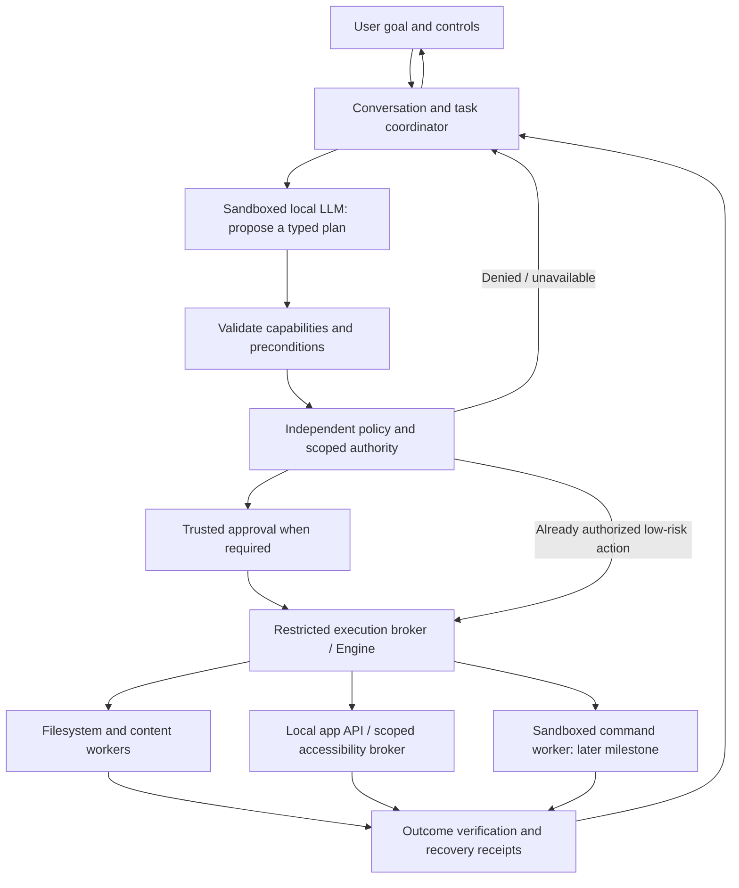

# Custodian offline operator: product and hackathon master plan

**Planning date:** 16 October 2026. **Status:** proposal; implementation not started by this document.

**Instruction when this plan was written:** planning only. Do not treat this plan as authorization
to change application code, run builds/tests, install software, alter settings,
schedule jobs or execute user tasks. Only planning documents are produced now.

The owner subsequently requested implementation. Current progress and its
limits are in the [offline foundation report](OFFLINE-FOUNDATION-IMPLEMENTATION-2026-10-16.md).
The original planning text below does not override that later authorization.

The [17 October Laya integration plan](LAYA-INTEGRATION-PLAN-2026-10-17.md)
refines offline semantic screening, standing-permission dependencies, model
evaluation and activation gates. It is a proposal, not implemented capability.

## 1. Objective and constraints

Build a compelling offline Windows operator that accepts a useful goal, plans
work, requests the necessary authority, executes through controlled capabilities,
checks the actual result and provides a dependable recovery path.

The competitive objective is an unusually convincing combination of practical
automation, local execution, enforceable user control and evidence. Winning and
being better than every competing product cannot be guaranteed. Differentiation
must be demonstrated, not inferred from the feature list.

Confirmed decisions:

- Online functionality is future scope. No cloud inference or browser/account
  workflow is needed to complete an offline task.
- The user has substantial time available. Use milestone exit gates rather
  than the earlier provisional 15-day schedule.
- Initial delivery is Windows with text interaction. Whole-PC scope means
  accessible local volumes and arbitrary permitted paths, not six fixed folders.
- User-defined private zones, credential protection and OS permissions constrain
  access. Broad filesystem scope does not imply unrestricted authority.
- Examples demonstrate reusable capabilities; they do not become the only tasks
  the product can perform.
- The project is not a universal administrator, antivirus product, backup product
  or guarantee that every action is harmless.

Unknowns: exact event rubric, existing-code eligibility, team availability,
submission format and target hardware. Record them when available; do not
invent dates, staffing, event requirements or market-leadership claims.

Event rules matter. For example, MLH publishes criteria covering technology,
design, completion and learning, and its standard rules restrict prior project
work. This is an example, not this event's confirmed rubric. Validate the actual
event before committing submission materials. [MLH standard rules and criteria](https://github.com/MLH/mlh-policies/blob/main/standard-hackathon-rules.md)

## 2. Starting point: reuse evidence, not assumptions

The [capability audit](VISION-CAPABILITY-AUDIT-2026-10-16.md) is the baseline.
The [execution report](VERIFICATION-2026-10-16.md) records earlier checks; no
checks are rerun or newly certified by this planning exercise.

| Area | Reuse | Work still required |
| --- | --- | --- |
| Local inference | Pinned CPU model, optional GPU model, packaged Node/agent, real AppContainer inference | Honest readiness, latency/resource characterization, general task planning |
| File work | Whole-drive discovery, metadata, move/copy/rename/folder creation, receipts and selected undo | Private zones, uniform policy, batching, content operations, races and crash recovery |
| Task execution | Durable lifecycle records, resource locks, task display and scan cancellation | One authoritative execution contract, scoped cancellation and multi-step reconciliation |
| User controls | Exact file approvals and some settings approvals | Unified scoped grants, revocation, broader consequence previews, per-app permissions |
| Applications | Start-menu launching and normal close requests | Read/act/verify control inside local apps |
| Packaging | A runtime-inclusive Windows installer and isolated inference evidence | Clean-profile offline installation, operation, recovery and uninstall |
| Evaluation | Earlier 315 Rust/121 JavaScript passes; 56/57 model cases for each tested model | End-to-end task benchmark, privacy attacks, live app work and independent user validation |

The 57-case model evaluation uses simulated desktop results. Its score is not
an end-to-end task-success rate or a product-completion percentage.

## 3. Product definition and user value

Start validation with people who repeatedly organize, inspect and prepare local
work materials. Students, freelancers and office workers are candidate groups,
not three simultaneous release personas. Choose the first audience after
observing actual tasks.

Planned discovery: observe at least five consenting users, record recurring
tasks, manual steps, time, errors and privacy concerns. Use synthetic or
voluntarily supplied non-sensitive material. Select workflows by frequency,
measurable benefit, feasibility and safety. Do not collect credentials or
confidential files as convenient test data.

Three initial workflow families are proposed for validation:

| Family | Example outcome | Reusable abilities it exercises |
| --- | --- | --- |
| Prepare a local handoff | Gather allowed project materials across locations, create an inventory and archive, open a report for review | Discovery, content/metadata reading, planning, batch changes, artifact generation, archive verification, local app interaction |
| Update a local document/report | Use permitted source material to produce or update a report; review it in a supported editor and save verified output | Source grounding, document extraction, generation/editing, app APIs/accessibility, save verification |
| Recover and adapt | Detect a changed file after approval, request revised authority where necessary, complete permitted work, then undo without overwriting newer work | Freshness, consent binding, recovery, bounded replanning and conflict handling |

These are candidates, not claims of current support. Keep whichever workflows
user validation supports. Preserve a broad capability model beneath them.

The hackathon entry should demonstrate at least three task families, including
a task spanning files and an app, with changed inputs. It must not rely on
recognizing an exact rehearsed sentence or a fixed fixture path.

## 4. Scope and priority

| Priority | Scope | Exit requirement |
| --- | --- | --- |
| P0: foundation | Truthful capability inventory, permissions/private zones, offline boundaries, trusted execution and recovery | All required privacy/authority cases pass before exposing broader capabilities |
| P1: core offline entry | Broad permitted file work, content and artifacts, supported local app control, multi-step tasks, clear UI, installed runtime | Real supported workflows pass their artifact/app-state and recovery checks |
| P2: broader offline product | More local formats/apps, supported settings, routines, semantic retrieval, restricted development tools, local software management | Each addition has its own boundaries, verifier, recovery and held-out evidence |
| P3: optional offline extensions | Voice, additional local media capabilities, more languages, richer personal routines | Promote only if useful and measured without degrading P0/P1 reliability |
| Deferred | Online browsing/research, connected accounts, sending/sharing, cloud inference, online installers, multi-device services | Separate future network and consent design; never counted as delivered offline features |
| Later platform releases | macOS/Linux | Separate native policy/app adapters, packaging and acceptance; portable code alone is insufficient |

Critical changes remain blocked by default: disabling protections, boot/recovery
tampering, credential extraction, unrestricted privileged shells and overriding
private zones. Local uninstall/delete/install functions are high-consequence
capabilities requiring separate implementation and evidence, not automatic
consequences of adding a command runner.

### Coverage of the larger offline vision

Deferring online services does not mean abandoning other offline domains.
The table separates core delivery from subsequent offline releases. Every
future capability still requires its own execution and security evidence.

| Domain | Core delivery | Broader offline release |
| --- | --- | --- |
| Desktop/UI | Supported app observation/action, local editor workflow, launch/list/normal close | More app adapters, window management, supported notification controls; no unrestricted operation of unknown controls |
| Files/storage | Search/read supported material, create/edit/move/copy/rename, organize, archive, verified recovery | Versioned local backup/restore, supported tree operations, governed deletion/cleanup and additional filesystem cases. Undo alone is not backup |
| System/settings | Verified current supported personal settings and measured system facts | Audio, display, power, defaults, supported peripherals and reversible startup configuration. Local adapter/Bluetooth configuration is distinct from online services; critical protection/driver changes remain outside ordinary authority |
| Software/development | Truthful unavailability where no safe executor exists | Restricted local code editing, Git without remote transfer, offline builds/debugging and verified local installers/updates/uninstall. Toolchains/dependencies must already be present; hooks/plugins require explicit containment |
| Communication | Local reminders and task list | Local draft documents/EML, ICS calendar artifacts and permitted contact-file processing. No account access, sending, invitations or synchronization in this release |
| Content/productivity | Supported text/structured content, grounded reports, local review and archive artifacts | Validated DOCX/PDF/spreadsheet/slide workflows, OCR and local image/audio/video operations where useful and resource-feasible |
| Complex tasks | Multi-step work composed from trusted file/content/app primitives | More capabilities and bounded routines added without one-off commands for each example |
| Interaction | Accessible text UI and clear progress/control | Evaluated multilingual execution and optional local voice; no claim that a model's language coverage proves task execution quality |

Local backup requires restore drills and explicit storage/retention policy.
Local software management requires supported package-specific verification;
software signing alone is not proof that installation is harmless. Debugging
authority must be bound to an approved target, not arbitrary user processes.

## 5. Architecture to implement

Reuse Rust/Tauri, the local Node/model service, existing protocol components and
durable records. Add narrowly justified components. Do not introduce a new
framework, database or model merely to appear more sophisticated.

Authority resides in trusted code and consent, not model output. The UI is a
presentation surface, not a signing oracle. All writes ultimately use the
dedicated execution boundary; all reads also pass policy before acquisition.
Worker processes never receive blanket access to the whole PC.

Planned authority separation:

- The model receives only approved observations and capability descriptions.
- Policy evaluates the actual operation, target, scope, risk, grant and current
  policy version. A model cannot create or extend a grant.
- Engine executes only authenticated, validated, authorized requests and emits
  receipts. Native GUI/command tools cannot bypass this contract.
- Readers/converters/scripts receive narrowly selected inputs and output areas.
- Audit and recovery records are maintained outside the model's writable area.

AppContainer provides resource isolation when configured with the appropriate
rights; a sandboxed model does not isolate the desktop broker or launched apps.
[Microsoft AppContainer documentation](https://learn.microsoft.com/en-us/windows/win32/secauthz/appcontainer-isolation)

Job objects will manage worker lifetimes and resource limits. They do not by
themselves authorize filesystem/network access or guarantee that every possible
child process is contained; child creation and breakaway paths must be tested.
[Microsoft job objects documentation](https://learn.microsoft.com/en-us/windows/win32/procthread/job-objects)

### Architecture decisions before implementation

Record decisions rather than silently replacing the canonical design:

| Decision | Planned resolution work |
| --- | --- |
| Engine-only mutation | Map current desktop write routes, bridge them to guarded execution, then remove bypasses with regression coverage |
| Durable orchestration | Compare current coordinator/receipts with canonical Temporal/PostgreSQL commitments; measure recovery, deletion/privacy parity and deployment cost before approving any simplification |
| Model/framework choice | Benchmark the existing pinned models first; preserve working code unless a measured alternative improves execution and deployment |
| App automation | Native/document APIs first, scoped accessibility second; visual control only after privacy and verification can be enforced |
| Private-zone identity | Define path/object identity, alias/hard-link handling, cache invalidation and conservative refusal for unresolved cases |
| Command execution | Decide the enforceable sandbox and supported executable/toolchain set before exposing a runner |

These are planned decision records. They do not modify the original architecture
or authorize an implementation deviation during this planning turn.

## 6. Shared execution contracts

Use versioned contracts shared across process boundaries. Validate unknown,
missing and inconsistent authority-bearing fields; bound frame and payload sizes.

| Contract | Required information |
| --- | --- |
| Capability | Stable ID/version; real availability; allowed inputs; read/write/app/network effects; risk; scope; verifier; undo strategy; sandbox/resource needs; supported versions |
| Task | Task/conversation/request IDs; original goal; authorized scope; policy version; state; dependencies; resource locks; budgets; cancellation/recovery state |
| Observation | Object/version references; authorized source; timestamp; measured facts; trust label; requested/allowed/actual coverage; exclusions; freshness |
| Plan | Typed steps and dependencies; exact effects; object identities/preconditions; destinations; resources; verification; inverse strategy; required authority; expiry; digest |
| Grant | Trusted issuer; task/capability/object scope; expiry; policy version; approved plan digest; revocation and replay rules |
| Receipt | Actual attempted/completed/failed effects; independent verifier outcome; durable record reference; recovery/undo availability and preconditions |

Display paths for permitted objects to the user. References are not authority;
resolving “it” requires fresh, unambiguous observations. Never show private paths
to the model merely to explain why access was denied.

Task states: queued, observing, planning, awaiting approval, running, verifying,
completed, partial, failed, cancellation requested, cancelled and recovery
required. Undo is a separate verified operation linked to the original receipt.

Only the coordinator/Engine can authorize a verified completion state. Model
text and successful transport responses are not completion evidence. Preserve
per-item truth for partially completed batches.

## 7. Safety, privacy and offline rules

| Rule | Required design |
| --- | --- |
| Deny before access | Check private/credential boundaries before enumeration, metadata, reads, indexing, previews, app observations or model context; do not enumerate a private tree to decide to exclude it |
| Equivalent objects | Handle case, volume aliases, junctions, links, replacement and races; deny unsupported/uncertain cases instead of guessing. Prefer validated handles and identity checks over string-only decisions |
| Revocation | Invalidate pending plans/grants; stop forward work; discard associated model context and invalidate retained observations/index access when privacy rules change |
| No private logging | Exclusion counts/categories can be shown without names/content. Diagnostics use opaque references. Recovery data for authorized changes has restricted storage and retention |
| Least authority | Temporary scoped permissions, no always-on admin, no model-generated consent, no silent expansion from selected files to a whole drive |
| Risk rules | Permitted low-risk reads may proceed automatically; consequential edits/settings require appropriate previews/grants; deletion/uninstall requires action-specific authority and recovery checks; critical operations deny by default |
| Untrusted content | Documents, filenames, extracted text and app contents cannot override rules, add capabilities or create approval. Separate source data from executable instructions |
| Offline enforcement | Gate model acquisition, updates, URL/browser handoffs, connectors, worker networking and fallback paths. Missing assets produce an error, not a silent download |
| External apps | Use supported offline-capable apps and verify with connectivity unavailable. Never claim that Custodian can prevent unrelated apps/services from networking merely because its model is sandboxed |
| Storage limits | Check free space before staging/backup/journal changes. Disk-full, record-write or integrity failures prevent mutation before it starts |
| Threat boundary | Defend against model/content-driven misuse. Do not claim immunity from an administrator, compromised OS, or arbitrary same-user malware. Signing/DPAPI do not remove that boundary |

Privacy policy must also cover backups, temporary extraction, clipboard use,
archive names, error text and diagnostic bundles. Retention removal is not a
claim of forensic erasure. Unknown authority or unverifiable state fails closed.

## 8. Capability implementation approach

### Files and local storage

Preserve whole-PC discovery with truthful scope and exclusions. Unify folder
opening, file opening, metadata, content, batch actions and cleanup under policy;
do not retain inconsistent personal-folder limits in some routes.

For mutations: observe → plan → obtain authority → revalidate → persist prepared
recovery → execute → verify → commit receipt. Stage outputs and use atomic
replacement where the filesystem supports it. Cross-drive batches are not
globally atomic: record each item, reconcile interruption, and report partial
effects. Undo must refuse or resolve conflicts without destroying newer work.

Add text/Markdown/CSV/JSON output and supported local edits first, then archive
creation/extraction. Archive readers must reject traversal, device/link tricks,
excessive expansion and ambiguous collisions. Verify archive entries and payloads.
Separate supported directory-tree operations from existing single-file support.

### Content and artifacts

Start with bounded text and structured files; then text PDFs and document/
spreadsheet formats needed by validated users. Specify format, encoding, size,
page/sheet limits, encrypted-file behavior and installed dependencies. OCR,
scanned PDFs, slides and local media support are separate capabilities.

Run parsers without network or macro execution. Ground extracted facts and
summaries in source locations. Verify exact structured facts deterministically;
evaluate subjective prose quality separately. Saving a file is insufficient if
its content or layout is wrong. Keep originals and test failed/partial edits.

Semantic search follows working extraction and privacy-filtered indexing; a
zero-vector placeholder must never be presented as semantic retrieval.

### Local application control

Build a broker scoped to approved processes, windows, objects and actions.
Start with a supported local editor; add a second productivity application only
after the first passes. Select actual app versions during the compatibility spike.

Use documented app APIs and accessibility control patterns. UI Automation
offers patterns such as Invoke, Value and selection/scroll behaviors; application
support varies. Validate each supported adapter rather than promising any app.
[Microsoft UI Automation patterns](https://learn.microsoft.com/en-us/windows/win32/winauto/uiauto-controlpatternsoverview)

Re-observe after actions; verify saved artifacts when possible. Check target
window identity, focus and unexpected dialogs. Never type global keystrokes
blindly or repeat an uncertain consequential click. Do not automate consent or
credential dialogs. If private content cannot be excluded before acquiring a
window's text/image, deny observation or require a different supported route.
Full-desktop screenshots/OCR are not an initial fallback.

GUI reversibility must be declared. An arbitrary button may have effects that
cannot be inferred or undone; unsupported consequential UI actions require a
safe handoff rather than guessed automation.

An app/process grant alone is not permission to read every tab or document in
that app. The broker must bind observations to the approved document/window
and allowed elements, or refuse when that binding cannot be established.

### Multi-step planning and execution

The model proposes typed steps from available primitives. Trusted code checks
the dependency graph, authority, budgets and recovery. Observe between steps,
reuse fresh evidence and replan only within existing grants. Material changes
require renewed authority.

Use explicit step/time/resource budgets and bounded replanning. Reconcile
unknown mutation outcomes by transaction/object IDs before retrying. Separate
conversation from task execution so an independent question cannot cancel or
overwrite another task. Retain locks until workers acknowledge safe stopping.

### Settings, routines and development tools

Extend settings from validated needs, with exact prior values, write-ahead
recovery and read-back verification. A Settings-app launch is not a settings
change. Keep critical protection/boot settings outside ordinary authority.

Routines use persisted, inspectable triggers and current permissions. Prevent
duplicate catch-up execution after restart; allow disable/revoke without losing
task truth. No proactive mutations without an explicit routine grant.

For later commands, approve executable identity, argument structure, working
directory, selected inputs/outputs, environment, subprocesses and limits. Deny
network and undeclared access in the worker sandbox. Build tools, Git hooks and
plugins can execute code: treat them as code, not harmless strings. A job object
or a command-name allowlist alone is insufficient.

Offline local installers/uninstallers need disposable-environment experiments,
publisher checks, consent, interruption analysis and an honest recovery contract.
Never promise generic uninstall/restore for installers with unknown side effects.

## 9. Milestone sequence and dependency gates

All future implementation rows below are **planned**, not completed. Existing
passing evidence establishes a baseline only. Reuse current mechanisms where
their contracts match; harden or migrate them where they do not.

| Milestone | Deliverable and principal work | Dependency | Exit gate |
| --- | --- | --- | --- |
| M0. Product and evidence contract | Confirm audience/problem, capture event constraints, freeze baseline capability matrix and test definitions; record architecture decisions | None | Clear supported/deferred list; user-observed workflow; no unsupported production/security claim |
| M1. Truthful offline surface | Real availability states; distinguish model loading/ready; block online handoffs; remove exposed fake-success paths | M0 | Every offered action is implemented or explicitly unavailable; offline errors do not launch/download anything |
| M2. Policy and private zones | Shared policy, scoped grants, private-zone UI/storage, default secret restrictions, revocation and read-before-access enforcement | M1 | Privacy/authority gate passes across current direct/model/context/history routes; allowed whole-PC file journey still works |
| M3. Trusted execution and recovery | Engine-only mutations, bound approvals, write-ahead records, verification, idempotency/reconciliation, cancellation and conflict contracts | M2 | Refusal, crash, changed-target, occupied-destination, record failure and verified undo cases pass |
| M4. Reusable file/content primitives | Uniform arbitrary permitted paths; batch/directory semantics; bounded readers; text/structured edits; archive handling and artifact verification | M3 | Actual supported files/archives match expectations; unsafe/unsupported inputs refuse honestly; existing cross-drive journey remains correct |
| M5. Real task planner/coordinator | Typed multi-step plans, observations, authority-aware replanning, per-task state/locks, independent chat, safe cancellation | M3; integrate M4 as ready | Unrehearsed file/content goal completes through real handlers; ambiguous, stale and partial states are accurate |
| M6. Local app broker | API/accessibility spike, supported editor adapter, app privacy/authority binding, re-observation and save verification | M2/M3; integrate M5 | Real create/open/edit/save task in a declared app version, with changed inputs, safe focus handling and verified saved bytes |
| M7. Complete offline workflows | Integrate validated task families; add second app/format only for demonstrated user value; end-to-end recovery UI | M4/M5/M6 | Three task families work; at least one spans files and an app; instructions and paths vary without new scenario-specific code |
| M8. Adversarial and resource hardening | Negative/privacy fixtures, injected failures, interrupted workers, contention, cold/warm measurements, low-space and model-unavailable modes | Starts at M2; final pass after M7 | Required safety cases all pass; no false completions; responsiveness and resource budgets met on declared hardware |
| M9. Held-out evaluation and usability | Freeze representative tasks, independent variations and manual comparison; consented user trials; review errors | M7/M8 | Proposed benchmark gates pass and raw limitations remain visible; beginners can start/stop/recover without developer guidance |
| M10. Installed release acceptance | Reproducible package, license/model checks, clean-profile install/use/uninstall offline, final-artifact repetition and hash record | M8/M9 | Final installed product passes core journeys and recovery; no checkout/runtime dependencies or hidden network requirements |
| M11. Hackathon entry | Evidence-backed demo, concise technical explanation, reproducible evaluation, submission/rule review, recorded fallback | M10 | Every demo claim maps to passing evidence; live variations work; no mock presented as real execution |
| M12. Broader offline releases | More apps/formats, semantic search, supported settings/routines, restricted commands/Git/build tools, carefully bounded local software work; optional voice/media | M2–M10 foundations | Each capability is separately implemented, verified and documented before being exposed; expand the benchmark with it |

The implementation critical path is policy → trusted execution → primitives →
planner/app integration → adversarial/held-out evidence → installed release.
User discovery, interface design, test-fixture design and documentation can
progress alongside it if team capacity exists. Do not parallelize conflicting
authority/storage changes without explicit integration contracts.

### Planned repository work areas

| Work | Existing areas to reuse / planned extension |
| --- | --- |
| Policy and contract definitions | `crates/custodian-proto`, `custodian-approval`, `custodian-core`; final shared-policy placement needs dependency review |
| Engine and persistence | `crates/custodian-engine`, `custodian-journal`, `custodian-ledger`, core file tasks/coordinator and Windows filesystem primitives |
| Live routing and consent | `apps/desktop/src-tauri/src/assistant/`, approval service, app command registration |
| Model planning | `services/agent/src/llm.ts`, tool catalogue/selection, authenticated protocol, evaluation harness |
| Offline content workers | Existing parser/sandbox components; replace disconnected placeholders only when actual worker execution is integrated |
| Local app broker | Extend Windows integration and desktop launch functionality with a separately scoped automation boundary |
| Interface | `apps/desktop/src/` conversation, task state, approval, privacy controls and receipts |
| Acceptance/package | Existing desktop verification harness, targeted regression fixtures, runtime staging and installer configuration |

These paths are planning references. No code changes are made now.

### Operating rhythm and responsibilities

Use role ownership even if one person holds every role: product/evidence,
policy/security, execution/recovery, model/planner, app/content integrations,
interface, and release/quality. Team size is unconfirmed; do not assume a
parallel staffing plan.

For each work item: state the observed problem, define the completion test,
implement the smallest coherent slice, run targeted checks, review authority
and failure paths, then exercise the live user journey. Update the capability
matrix and evidence. A reviewer should be able to reproduce the outcome.

Every milestone review records: working evidence, failures, remaining risk,
scope/version, next dependency and explicit go/no-go. Stop adding capabilities
when a foundational gate fails. Diagnose the cause instead of weakening the gate.

## 10. Interface and experience

The interface should make control obvious without requiring technical knowledge:

1. **First use:** explain local operation, model readiness, supported tasks,
   whole-local-PC discovery and private-zone choices. Show actual permission
   implications without implying that offline automatically means private.
2. **Task intake:** restate the requested result and scope; ask only for details
   needed to resolve ambiguity or authority. Keep useful low-risk work moving.
3. **Plan:** show grouped effects, exact destinations, risk, affected items,
   recovery/space needs and omissions. All consequential items must be inspectable.
4. **Execution:** task card with measured progress, current stage, scope and
   independent Stop; support other questions without losing task state.
5. **Outcome:** show artifacts, locations, verification, partial failures and
   available recovery. Distinguish “saved” from “checked” and “verified complete.”
6. **Recovery:** explain what changed and what undo can restore. Show conflicts
   without offering an overwrite disguised as undo.
7. **Privacy:** persistent, understandable access controls with revocation.
   Excluded objects are not leaked through helpful previews or diagnostic text.

Keyboard navigation, readable contrast, clear focus, screen-reader names,
scaling and nontechnical failure messages belong in core acceptance. Animation
and mascot polish follow working interactions. Avoid approval fatigue through
properly bounded task grants, not silent approval of new consequences.

## 11. Evaluation strategy and proposed targets

Targets below are **future acceptance targets**, not current measurements or
guarantees. Establish hardware, supported apps and fixture sizes before timing.
The [acceptance matrix](OFFLINE-HACKATHON-ACCEPTANCE-MATRIX.md) defines cases.

### Different evidence answers different questions

| Evidence | What it proves | What it does not prove |
| --- | --- | --- |
| Unit/contract/property checks | Particular invariants and boundaries | A complete installed user journey |
| Real temporary-fixture integration | Actual filesystem/process effects and recovery | General app usability or every Windows machine |
| Model case evaluation | Selection/arguments under the stated harness | Actual desktop execution when results are simulated |
| Live end-to-end evaluation | Declared tasks worked through the actual interface and tools | Universal task competence or absence of all vulnerabilities |
| Adversarial fixtures | Resistance to the attacks actually attempted | A mathematical guarantee against every attack |
| User trials | Observed usability/value for those participants | Population-wide productivity or adoption |

### Functional and safety gates

- Keep the existing 57-case expectations and >=95% model gate; do not round
  up, omit difficult cases or equate its four deletion-claim checks with security.
- Proposed new end-to-end set: 20 held-out tasks—six file/storage, four content,
  four app, four cross-capability and two recovery tasks. Freeze inputs/scoring
  before evaluation. Target at least 18/20 verified completions, with every
  failure retained. Missing required families still fail release acceptance.
- Require every mandatory workflow and every required privacy/authority case
  to pass. A privacy breach, unauthorized mutation or false completion is a
  release blocker even if an aggregate task score exceeds its target.
- Repeat each declared core journey five consecutive times on final artifacts,
  including cold/restart states. Add unseen paraphrases, different paths,
  duplicate names, file changes and supported app versions.
- Keep development and held-out task sets separate. After fixing against the
  held-out set, declare that adaptation and introduce new independent cases.

### Proposed responsiveness and resource targets

| Measurement | Initial target / treatment |
| --- | --- |
| UI command acknowledgement | <=250 ms on the declared test setup; planning may continue after acknowledgement |
| Stop acknowledgement | <=250 ms; mark stopping immediately and prevent later steps |
| Cancellable scan stopping | <=1 second on the defined fixture; measure full-drive behavior separately |
| Noninterruptible OS action | Show stopping, preserve recovery and report actual effects; never claim it stopped before acknowledgement |
| Model cold readiness | Pass real knowledge/tool smoke within the existing 120-second inactivity contract; separately record total cold loading/hash verification time |
| Warm ordinary planning | Initial target p95 <=10 seconds on the declared CPU setup, measured separately from actual task execution |
| Memory | Retain current 4 GB model-worker ceiling initially; measure total process-tree peak, idle usage and repeated-task growth before publishing hardware requirements |
| Large scans/content | Bounded memory/output, progress, cancellation, complete/partial coverage and declared format limits; do not impose a hidden cutoff and call results complete |

Measure cold and warm behavior separately and publish hardware/model/version,
sample size, p50/p95, failures and setup assumptions. GPU support remains
optional until separately verified. No unrestricted fallback to meet a deadline.

### Value measurement

Have consenting participants attempt representative tasks manually and with
Custodian; balance order where possible. Record correctness, active human time,
elapsed time, interventions, retries and recovery success. Report raw results
and participant count. Do not claim statistical significance or a universal
time-saving percentage from a small convenience sample.

## 12. Failure handling and recovery

| Event | Required behavior |
| --- | --- |
| Unsupported task/format/app | State the limitation; offer a bounded alternative without inventing execution |
| Missing model/runtime asset | Explain unavailable capability; retain independently working deterministic tools; no download in offline mode |
| Private or unauthorized target | Deny before access; provide a generic reason without exposing private details |
| Changed source/destination or revoked grant | Invalidate stale authority; re-observe only permitted objects; obtain new authority for changed effects |
| Disk full / journal unavailable | Refuse before mutation; preserve originals and show a meaningful recovery action |
| OS call succeeds but receipt update fails | Reconcile observed state and prepared record; mark recovery required, not success or safe-to-repeat |
| App focus changes / ambiguous dialog | Stop forward interaction, inspect only allowed state and ask for clarification/handoff |
| Stop / restart / crash | Retain exact completed effects, clear unsafe authority, reconcile work and expose recovery; never silently replay mutations |
| Undo conflict | Preserve newer work; explain options and obtain specific authority where an alternative is supported |

Differentiate cancel, undo and cleanup. Cancellation is not a promise that
already completed changes disappeared. App/installer side effects without a
valid recovery method are not advertised as reversible.

## 13. Risk register and contingency decisions

| Risk | Early experiment / mitigation | If the experiment fails |
| --- | --- | --- |
| Private-zone bypass through reads or GUI | Synthetic canaries, aliases, caches and excluded app/window tests at M2 | Block wider content/app exposure; repair the boundary before expansion |
| Existing write paths bypass Engine | Route inventory and per-entry regression at M3 | Disable the unguarded capability; do not ship two competing authority systems |
| Small local model cannot plan reliably | Compare typed plans on held-out goals with the existing pinned models | Use validated bounded decomposition; declare unsupported complex tasks; benchmark a larger local model only on supported hardware |
| UI Automation differs by app/version | M6 spike on real declared editor versions and display settings | Prefer app API/format-level operation; narrow supported app versions explicitly; no blind-click fallback |
| Generic script runner cannot be contained | Child-process/filesystem/network escape tests in a disposable environment | Keep development execution unavailable; do not replace sandboxing with prompt warnings |
| Parser or archive input escapes / exhausts resources | Malformed, macro, oversized and expansion-limit fixtures | Restrict supported inputs and fail closed; defer unsafe formats |
| Recovery corrupts newer data | Replacement, disk-full and crash-point tests | Stop mutations in the affected family until reconciliation works |
| Whole-PC I/O affects the user's work | Scan throttling, contention, cancellation and low-resource measurements | Reduce background intensity and offer scoped/cached discovery with truthful coverage |
| Scope overwhelms integration | Require milestone exits and capability availability states | Freeze optional formats/apps/voice; preserve core correctness |
| Clean Windows environment unavailable | Arrange a disposable profile/VM or separate machine before M10 | Installed release acceptance stays open; do not replace it with “installer generated” |
| Existing-code rules incompatible | Check actual event policy at M0 | Choose an eligible event or an explicitly permitted new contribution; do not conceal prior work |

## 14. Hackathon demonstration and judging evidence

The competitive argument is a hypothesis: an offline operator can reduce
repetitive local work while making permission, execution and recovery visible.
Test this argument with users and execution evidence. Do not claim the idea is
unique or superior to all competitors without a specific comparison.

Build evidence for usefulness, technical substance, autonomy under changed
inputs, clarity and trust. Translate it to the actual event rubric when known;
do not manufacture weights or let a high internal score certify likely victory.

### Proposed live demonstration

Prepare a three-minute version, then shorter/longer variants for the event:

| Segment | What judges see | Evidence behind it |
| --- | --- | --- |
| 0:00–0:20 | A concrete local-work problem and a task request with varied paths | User-observed need; no claim that every computer task is supported |
| 0:20–0:45 | Measured findings, permitted scope and a comprehensible plan | Actual authorized observations; private fixture canary absent from observations/context, with independent test evidence |
| 0:45–1:35 | Approved batch/artifact work and an actual edit/save in a supported local app | Real Engine/app execution, not opening an app and pretending the edit happened |
| 1:35–2:15 | Changed input or stale approval causes a safe refusal/replan | New observation, no stale mutation, clear renewed consequences |
| 2:15–2:45 | Verified output and dependable undo/recovery | Actual artifacts/receipts; unchanged originals and conflict-aware restoration |
| 2:45–3:00 | Honest support limits, offline evidence and measured result | Declared app/model/hardware, raw benchmark summary, remaining work |

Use one clean scenario that fits real execution time; remove a segment rather
than accelerate or conceal execution. If the model is warmed for the demo,
state that and supply cold-start results separately. Run with connectivity
unavailable; do not use external services behind an “offline” label.

Keep a labelled real recording as a fallback, produced from the release build.
Never swap in mocks or prerecorded results without telling judges. Support a
judge-changed task variation; expose unsupported actions honestly.

### Submission package

- Working offline build with installation instructions and declared hardware.
- Architecture and authority diagram; precise supported capability matrix.
- Unedited task traces where appropriate, privacy-safe failure evidence and
  reproducible synthetic fixtures.
- End-to-end metrics with raw failures; model metrics labelled separately.
- Short demo and event-compliant presentation/submission answers.
- Clear originality/contribution statement, dependency/model licences and
  AI-assisted-development disclosure where required.
- Known limitations, threat boundary and reproducible setup/version information.

Polish should clarify the working system. Additional animation, more model
names or a longer feature list cannot compensate for an unverified task.

## 15. Packaging, release and completion

Use a release candidate freeze: no new capabilities after the final evaluation
set begins unless a documented defect requires a fix and relevant reevaluation.
Build from a known source state, record dependency/model hashes and produce
checksums. Separate signed-production distribution goals from an unsigned
development entry; never imply an unsigned package is signed.

The full offline package must include required runtimes/models or state any
explicit prior setup requirement. No automatic online repair. Check licence
and redistribution terms before bundling assets; pin tested versions.

Validate clean-profile install, first launch, model readiness, real supported
tasks, Stop, restart, recovery, uninstall and preservation of unrelated data.
Use final executable/installer hashes to tie evidence to the delivered build.
Windows Sandbox is currently unavailable on the development machine, so obtaining
a clean test environment is planned work, not completed evidence.

Offline release completion requires all of the following:

1. The published supported capabilities execute through the real interface and
   trusted tools, with declared format/app/hardware limits.
2. Private zones and policy are enforced across every exposed read/write/app
   route; required negative tests pass.
3. Supported consequential actions have valid authority, preconditions,
   verification and truthful recovery behavior.
4. Multi-step tasks adapt to new supported inputs without scenario-specific code.
5. Offline operation, usability, responsiveness and installed runtime pass their
   gates; recorded limitations are visible to users and judges.
6. Required held-out tasks, repeated core journeys and final-artifact checks pass.

Completion of this offline release does not certify all possible offline tasks,
all applications, other operating systems, the deferred online scope or immunity
from every attack. Every P2/P3 addition repeats these gates before promotion.

## 16. First implementation package, when requested later

Start with M0/M1/M2, not a new model or a general shell. The first reviewable
package should contain: a truthful capability/offline-mode inventory, typed
policy decisions, persisted private-zone/default secret rules, policy on current
discovery/metadata/context paths, offline-handoff refusal, privacy controls and
synthetic denial/revocation/alias fixtures. Its positive regression is the
existing allowed cross-drive file journey.

Before coding, resolve the necessary architecture decisions and exact test
fixtures. After coding, the package must prove private material stays out while
permitted whole-PC work continues. If that fails, do not expose broader reading,
app observation or script execution.

**Nothing in this plan has been implemented or scheduled by this document.**

## 17. Related planning and evidence

- [Detailed acceptance matrix](OFFLINE-HACKATHON-ACCEPTANCE-MATRIX.md)
- [Short offline implementation sequence](OFFLINE-EXECUTION-PLAN.md)
- [Current capability audit](VISION-CAPABILITY-AUDIT-2026-10-16.md)
- [Prior actual execution evidence](VERIFICATION-2026-10-16.md)
- [Existing detailed technical roadmap](CUSTODIAN_OFFLINE_ASSISTANT_IMPLEMENTATION_ROADMAP.md)
- [Existing acceptance requirements](ACCEPTANCE.md)

This master plan consolidates the delivery approach after the offline-only
scope decision. It does not rewrite historical verification results or silently
amend canonical design decisions.

